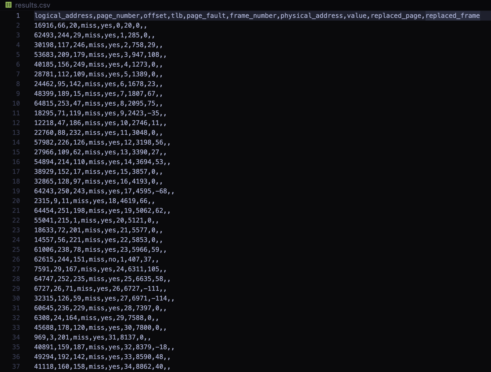
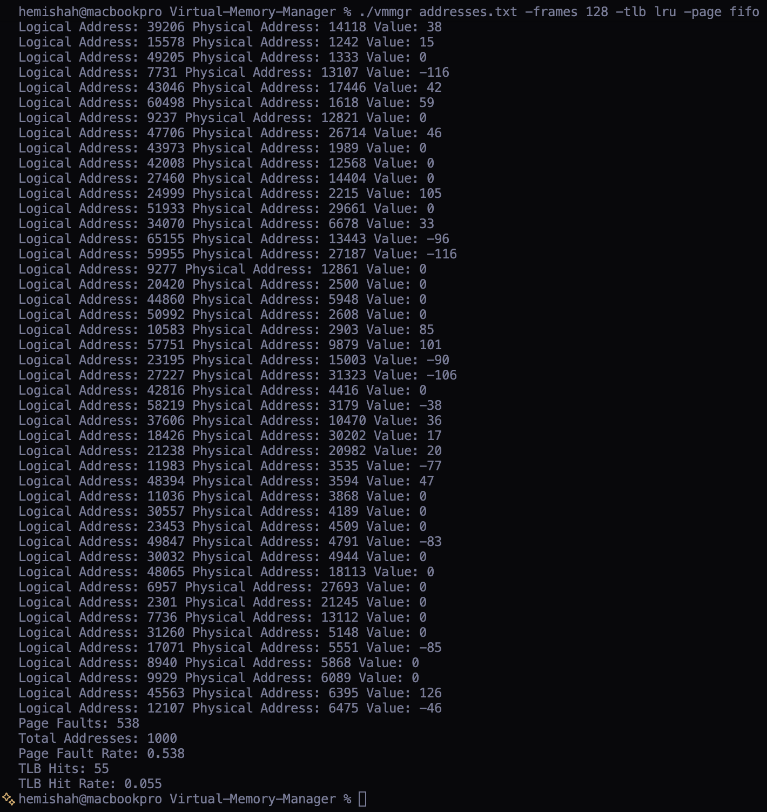

# Virtual Memory Manager
Operating Systems: CPSC 380 - Programming Assignment 3

## Author
Name: Hemi Shah  
Collaborator: [Add collaborator, if applicable]

## Design Overview
This program simulates a virtual memory manager that translates logical addresses into physical addresses. It uses a page table, a Translation Lookaside Buffer (TLB), and physical memory to perform address translation.

Each logical address is divided into an 8-bit page number and an 8-bit offset. The program first checks the TLB for the page number. If the page is found, the corresponding frame number is retrieved. Otherwise, the program checks the page table. If the page is not currently in memory, a page fault occurs, and the required page is loaded from the backing store into physical memory.

The TLB contains 16 entries and supports two replacement policies:
- LRU (Least Recently Used): Replaces the entry that has not been accessed for the longest time.
- Random: Replaces a randomly selected entry.

Physical memory supports up to 256 frames and can be configured to use fewer frames. When physical memory is full, the program replaces an existing page using one of three page replacement policies:
- FIFO (First In First Out): Replaces the page that has been in memory the longest.
- LRU (Least Recently Used): Replaces the page that has not been accessed for the longest time.
- Random: Replaces a randomly selected page.

The program reads logical addresses from an input file, retrieves the corresponding byte from physical memory, and outputs the logical address, physical address, and signed byte value.

It also tracks the total number of addresses processed, page faults, and TLB hits to calculate the page fault rate and TLB hit rate. The program can optionally generate a CSV file containing information about each address translation, including TLB hits and misses, page faults, frame numbers, and replaced pages.

## How to Compile
```bash
gcc vmmgr.c -o vmmgr
```
Optional command-line arguments:
- `-tlb lru` or `-tlb random`: Selects the TLB replacement policy.
- `-page fifo`, `-page lru`, or `-page random`: Selects the page replacement policy.
- `-frames N`: Sets the number of physical memory frames (1–256).
- `-csv filename`: Specifies the name of the CSV output file.

## Sample Output with Analysis Report
Sample Output:



- Which policy performs best under high locality?
    - The LRU replacement policy performs the best under high locality since it keeps the most recently accessed pages in memory, meaning that the same group of pages can be accessed repeatedly. Thus, LRU is effective under high locality because it retains frequently used pages and avoids unnecessary page faults.

- When does LRU outperform FIFO?
    - LRU outperforms FIFO when recently accessed pages are likely to be accessed again. FIFO replaces pages based on when they were loaded into memory, whereas LRU considers how recently a page was accessed. This makes LRU more effective when some pages are accessed frequently while others are rarely used. Thus, under these circumstances, LRU outperforms FIFO.

- When does Random perform similarly to other policies?
    - The Random replacement policy performs similarly to other policies such as FIFO and LRU when the available memory is large enough to hold most of the pages being accessed, since fewer page replacements are required. It can also perform similarly to other policies when memory accesses have little or no predictable pattern, since replacing pages based on insertion order or recency does not provide a significant advantage.

- How does reducing memory size affect performance?
    - Reducing the memory size affects performance because the number of available frames decreases, which in turn increases the page-fault rate since fewer pages can remain in physical memory. Additionally, it increases the number of page replacements because pages need to be replaced more frequently to make room for new ones. It can also affect the TLB hit rate because more pages need to be reloaded and TLB entries need to be updated more frequently. Thus, having a smaller memory size can make the system slower and reduce its overall performance.